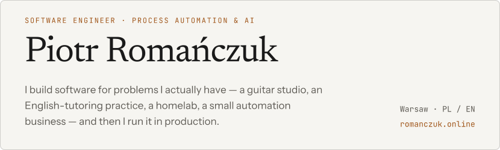
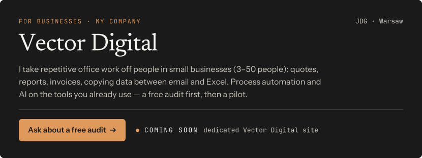
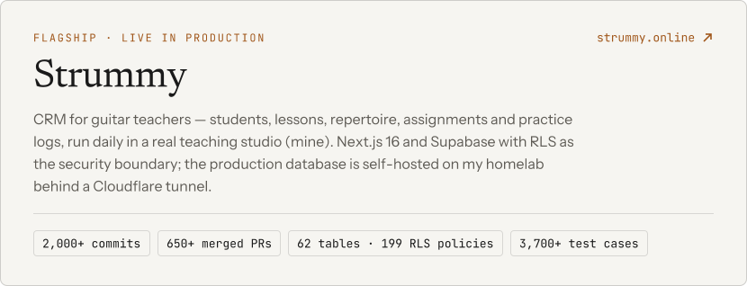
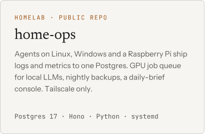
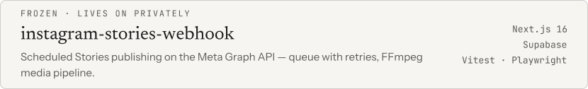
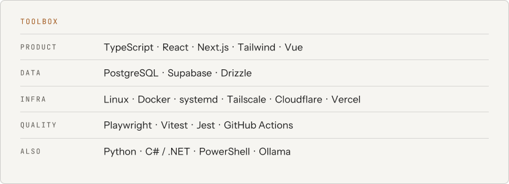

<a href="https://romanczuk.online"><picture><source media="(prefers-color-scheme: dark)" srcset="assets/hero-dark.svg"></picture></a>

[romanczuk.online](https://romanczuk.online) · [p.romanczuk@gmail.com](mailto:p.romanczuk@gmail.com)

<a href="mailto:p.romanczuk@gmail.com?subject=Audyt%20%E2%80%94%20Vector%20Digital"><picture><source media="(prefers-color-scheme: dark)" srcset="assets/vector-digital-dark.svg"></picture></a>

### What I'm building

<a href="https://github.com/PiotrRomanczuk/strummy"><picture><source media="(prefers-color-scheme: dark)" srcset="assets/strummy-dark.svg"></picture></a>

<a href="https://github.com/PiotrRomanczuk/home-ops"><picture><source media="(prefers-color-scheme: dark)" srcset="assets/home-ops-dark.svg"></picture></a><a href="https://github.com/PiotrRomanczuk/landing-portfolio"><picture><source media="(prefers-color-scheme: dark)" srcset="assets/portfolio-dark.svg"></picture></a>

<a href="https://github.com/PiotrRomanczuk/instagram-stories-webhook"><picture><source media="(prefers-color-scheme: dark)" srcset="assets/igsw-dark.svg"></picture></a>

### Also shipped

- **[INBORR](https://github.com/PiotrRomanczuk/INBORR---LandingPage)** — client landing page for apartment rentals, PL/EN, live at [inborr.pl](https://inborr.pl)
- **[giarddesign](https://github.com/PiotrRomanczuk/giarddesign)** — Vue 3 + TS + Tailwind landing page (recruitment task, CI + GitHub Pages)
- **[pizza-store](https://github.com/PiotrRomanczuk/pizza-store)** — pizza ordering UX built around XState state machines

### Behind the scenes (private repos)

- **[gitarawarszawa.pl](https://gitarawarszawa.pl)** — site for my guitar lessons; Cal.com bookings land in Strummy via webhook
- **[angielski.romanczuk.online](https://angielski.romanczuk.online)** — lesson notes + games for my English students, generated from lesson transcripts
- **job-radar** — daily job & lead collector feeding the home-ops Postgres
- **daily-brief** — morning/evening briefs written by scheduled Claude routines from my calendar and planner
- **monitor-manager** — Windows tray app + HTTP API for switching monitor layouts (C# / .NET 10)
- **Tender registry** — Outlook → Excel automation (PowerShell), first client of **Vector Digital**

### How I work

- Every project has a blueprint (domains, gap IDs, ADRs) and one planner vault as the source of truth.
- AI agents (Claude Code) are on the team — lint, typecheck, tests and E2E decide what merges, not the agent.
- I self-host what I can: Supabase, Postgres, GitHub runners, a local LLM on a Radeon GPU.

<picture><source media="(prefers-color-scheme: dark)" srcset="assets/toolbox-dark.svg"></picture>

<a href="https://romanczuk.online"><picture><source media="(prefers-color-scheme: dark)" srcset="assets/footer-dark.svg"></picture></a>
